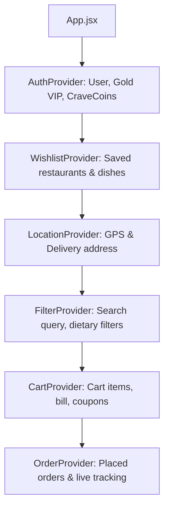

# 📂 CraveWave Architecture & Project Structure Guide

A comprehensive architectural overview and directory guide to help developers and users understand how the **CraveWave Food Delivery Platform** is structured, organized, and maintained.

---

## 🏗️ High-Level Directory Overview

```plaintext
Food Delivery Platform/
├── public/                       # Static public assets (served directly at root)
│   ├── favicon.svg               # Application brand logo icon
│   └── images/                   # Local high-resolution optimized food photos
│       ├── cuisines/             # 6 authentic regional cuisine showcase photos
│       ├── dishes/               # 605 unique localized dish photos (item-101 to item-705)
│       └── restaurants/          # Restaurant banner covers & logos
│
├── screenshots/                  # Verified device captures (mobile, tablet, desktop)
│   ├── desktop/                  # 1440x900 full page views
│   ├── tablet/                   # 768x1024 tablet layout views
│   └── mobile/                   # 375x812 responsive phone views
│
├── scripts/                      # Developer automation and generation utilities
│   ├── download_all_dishes.mjs   # Automated high-res dish image downloader
│   └── generate_restaurants.mjs  # Multi-city restaurant catalog generator
│
├── src/                          # Application source code
│   ├── assets/                   # Bundled graphics & hero banners
│   ├── components/               # Modular, reusable component library
│   │   ├── cart/                 # Cart slide-over & checkout drawer widgets
│   │   ├── feedback/             # User toasts & interactive status feedback
│   │   ├── home/                 # Homepage widgets (HeroBanner, CategoryBar, etc.)
│   │   ├── layout/               # Global shell (Navbar, Footer, MobileBottomNav)
│   │   ├── modals/               # All application dialogs & popups
│   │   ├── restaurant/           # Menu builder & item customization modals
│   │   ├── rewards/              # CraveCoins & Rewards Hub drawer
│   │   ├── search/               # Enhanced search modal with ⌘K keyboard shortcut
│   │   ├── tracking/             # Live delivery driver chat drawer
│   │   ├── ui/                   # Atomic UI primitives (Badges, Pills, Avatars)
│   │   └── index.js              # Master component barrel export
│   │
│   ├── context/                  # Global state management providers (React Context)
│   │   ├── AuthContext.jsx       # User auth, profile, Gold VIP, and wallet coins
│   │   ├── CartContext.jsx       # Multi-item cart, customizations, coupons, fees
│   │   ├── FilterContext.jsx     # Active category, cuisines, veg toggle, search
│   │   ├── LocationContext.jsx   # GPS geolocation & Indian delivery address picker
│   │   ├── OrderContext.jsx      # Order placement, active history & 5-step simulation
│   │   └── WishlistContext.jsx   # Favorited restaurants & dishes with local sync
│   │
│   ├── data/                     # Mock databases & initial state catalogs
│   │   ├── categories.js         # Top cuisine categories with icons & tags
│   │   ├── coupons.js            # Active discount coupons & promo validation rules
│   │   ├── featuredCuisines.js   # Featured cuisine items for homepage slider
│   │   ├── mockOrders.js         # Sample order history & 5-stage tracking steps
│   │   └── restaurants.js        # Comprehensive catalog of restaurants & 605 menu items
│   │
│   ├── pages/                    # Routed top-level page views
│   │   ├── HomePage.jsx          # Discovery feed, hero carousel, categories, filters
│   │   ├── RestaurantDetailPage.jsx # Dynamic menu, categories, and customizer
│   │   ├── CartPage.jsx          # Full dedicated shopping cart & bill review
│   │   ├── CheckoutPage.jsx      # Address input, payment methods & confetti
│   │   ├── OrderTrackingPage.jsx # Live GPS tracking map & 5-step delivery timeline
│   │   ├── OrderHistoryPage.jsx  # Past orders review with 1-click reorder
│   │   ├── LoginPage.jsx         # User login screen with preset demo accounts
│   │   ├── SignupPage.jsx        # Account registration screen
│   │   └── NotFoundPage.jsx      # 404 error page with quick recovery action
│   │
│   ├── utils/                    # Pure utility functions & business logic helpers
│   │   ├── calculations.js       # Bill breakdown, taxes, platform fee, and discounts
│   │   ├── formatCurrency.js     # Currency formatter (₹ INR / $ USD)
│   │   ├── indianAvatars.js      # Authentic avatar selector for drivers & users
│   │   ├── nutrition.js          # Macro nutritional breakdown calculator (calories/macros)
│   │   └── storage.js            # Safe localStorage reader & writer helpers
│   │
│   ├── App.jsx                   # Root application router & global layout wrapper
│   ├── index.css                 # Tailwind directives, animations & glassmorphism theme
│   └── main.jsx                  # React DOM entry point
│
├── index.html                    # Single-Page Application HTML host document
├── package.json                  # Dependencies, scripts, and project metadata
├── tailwind.config.js            # Design tokens, color palette, and layout extensions
└── vite.config.js                # Vite build and development server configuration
```

---

## 🧩 Component Architecture (`src/components/`)

Components are organized by **functional domain** to make files easy to find and eliminate deeply nested imports:

### 1. `components/ui/` (Atomic Design Primitives)
Contains lightweight, self-contained visual elements:
- `AmbientBackground.jsx`: Floating aurora glowing orbs with subtle culinary particles.
- `DietaryBadge.jsx`: Vegetarian (green square) / Non-Vegetarian (red triangle) emblems.
- `DishNutritionBadge.jsx`: Nutrition info pill (calories, protein, carbs, fats) with popup breakdown.
- `RatingPill.jsx`: Colored star rating chip (emerald green, amber, gold).
- `UserAvatar.jsx`: User profile avatar supporting custom themes, initials, and colors.
- `index.js`: Barrel export enabling `import { RatingPill, DietaryBadge } from '@/components/ui'`.

### 2. `components/modals/` (Dialogs & Popups)
Centralizes all popups and modal dialogs across the platform:
- `AuthModal.jsx`: Login/Signup popup with phone OTP and email simulation.
- `ConflictModal.jsx`: Multi-restaurant cart conflict alert.
- `CustomColorPickerModal.jsx`: Profile theme customization tool.
- `EditProfileModal.jsx`: User profile editor (name, phone, dietary preferences).
- `GoldClubModal.jsx`: VIP Membership upgrade dialog with animated gold aura.
- `LocationModal.jsx`: GPS locator and Indian locality address picker.
- `LogoutModal.jsx`: Logout confirmation prompt.
- `OffersNotificationsModal.jsx`: Flash deals and coupon notifications drawer.
- `WishlistModal.jsx`: Quick-access favorites drawer.
- Re-exports feature modals (`ItemCustomizerModal`, `CravingWheelModal`, `RewardsHubModal`, etc.) so you can import any modal from a single source!

### 3. `components/feedback/` (Notifications & Toasts)
- `AuthToast.jsx`: Unobtrusive floating notification confirming login, logout, and profile changes.

### 4. `components/home/` (Homepage Sections)
- `HeroBanner.jsx`: Floating food platter slideshow with coupon CTA buttons.
- `CategoryBar.jsx`: Quick food category selector pills.
- `FilterBar.jsx`: Dietary filters, sort by price/rating/delivery time.
- `RestaurantCard.jsx`: Interactive restaurant card with hover lift and ratings.
- `FeaturedExquisiteCuisines.jsx`: 6-column culinary carousel.
- `CravingWheelModal.jsx`: Interactive roulette wheel for indecisive foodies.

### 5. `components/layout/` (Application Shell)
- `Navbar.jsx`: Sticky luxury header with location, search, cart, and profile.
- `Footer.jsx`: Platform links, copyright, and social connections.
- `MobileBottomNav.jsx`: App-like bottom navigation bar for mobile devices.

---

## 🔄 State Management & Data Flow (Context API)

CraveWave uses React Context Providers wrapped hierarchically in `src/App.jsx`:



1. **`AuthContext`**: Manages user session, login/logout, profile details, Gold VIP status, and CraveCoins wallet balance.
2. **`WishlistContext`**: Stores favorited restaurants and dishes in `localStorage`.
3. **`LocationContext`**: Handles HTML5 Geolocation API, reverse geocoding, and manual delivery address creation.
4. **`FilterContext`**: Holds active search terms, selected cuisine filters, sorting options, and veg/non-veg toggles.
5. **`CartContext`**: Manages cart items, customization add-ons, quantity modifications, coupon code application, and tax calculations.
6. **`OrderContext`**: Holds placed orders, active tracking state, delivery partner details, and simulation controls.

---

## 🛣️ Routing Architecture (`src/pages/`)

| Route | Page Component | Description |
| :--- | :--- | :--- |
| `/` | `HomePage.jsx` | Discovery feed, promotions, cuisines, and restaurants |
| `/restaurant/:slug` | `RestaurantDetailPage.jsx` | Restaurant menu, categories, and item customizer |
| `/cart` | `CartPage.jsx` | Full-screen cart review, coupon code, bill breakdown |
| `/checkout` | `CheckoutPage.jsx` | Address verification, payment options, and confetti |
| `/track/:orderId` | `OrderTrackingPage.jsx` | Live GPS map, status timeline, and driver chat |
| `/orders` | `OrderHistoryPage.jsx` | Historical orders list with 1-click reorder action |
| `/login` | `LoginPage.jsx` | Full-page login screen |
| `/signup` | `SignupPage.jsx` | New user registration screen |
| `*` | `NotFoundPage.jsx` | Friendly 404 page with return-home CTA |

---

## 💡 How to Import Components

With the new barrel export system, importing components is straightforward:

```javascript
// ✅ Import any UI badge or primitive:
import { DietaryBadge, RatingPill, UserAvatar } from '../components/ui';

// ✅ Import any modal or dialog:
import { AuthModal, LocationModal, GoldClubModal } from '../components/modals';

// ✅ Import feedback components:
import { AuthToast } from '../components/feedback';

// ✅ Import layout shells:
import { Navbar, Footer, MobileBottomNav } from '../components';
```

---

## 🛠️ Adding New Features

### Adding a New Restaurant
1. Open `src/data/restaurants.js`.
2. Add a new restaurant object following the existing structure with unique `id`, `name`, `slug`, `cuisine`, and `menuCategories`.
3. Menu item photos reference `/images/dishes/item-<id>.jpg`.

### Adding a New Dish Photo
1. Place the JPG image into `public/images/dishes/item-<id>.jpg`.
2. In `src/data/restaurants.js`, set `image: '/images/dishes/item-<id>.jpg'`.

### Adding a New Discount Coupon
1. Open `src/data/coupons.js`.
2. Add your new coupon object with code, discount percentage, max discount, and minimum order value.
